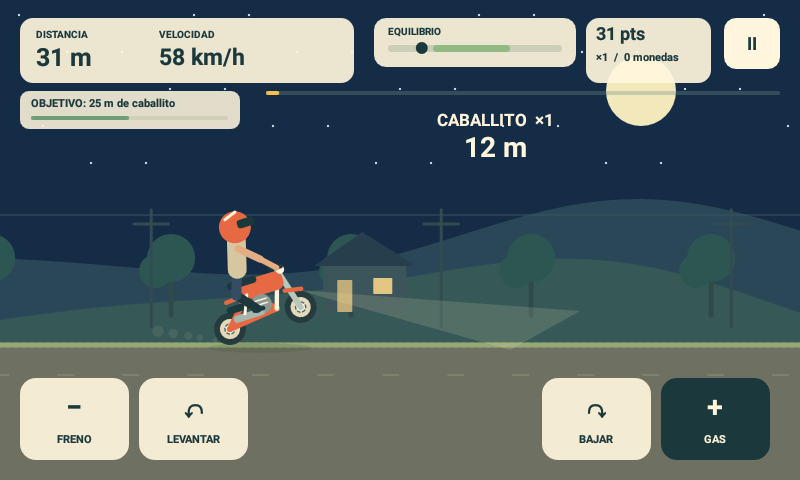

> **Estado: congelada en la versión 1.1.** El juego principal es la versión de macOS (`../wheelie-mac`, Swift/AppKit), que lleva muchas versiones de ventaja: trucos, progresión, rivales, clima, modo infinito, rutas largas y un arte completamente rehecho. Esta versión Android no recibe esas mejoras y se conserva solo como referencia histórica.

# Wheelie Ride

Juego Android nativo en Java/Canvas, inspirado en la conducción lateral y el equilibrio de [Wheelie Challenge](https://wheelie-challenge.softonic.com/android). Dibujos originales generados con Canvas, sin recursos ni código del juego de referencia. Funciona sin red ni permisos especiales; pensado para el Galaxy S3 Mini con Android 7.1.2.

La versión 1.1 incluye tres vehículos con dibujo y conducción distintos (trail, street y BMX), cuatro colores, campo diurno y nocturno, colinas, una ruta de 1.200 metros, conos y práctica sin obstáculos. Hay puntuación con multiplicador de hasta ×5 por mantener caballitos, tres objetivos por partida con recompensas, récords locales y un motor de sonido procedural desactivable. La moto es más grande durante la partida, el piloto se inclina al corregir y hay polvo, luz nocturna, señales de distancia y animación de caída. Funciona en horizontal a pantalla completa. Es una recreación del núcleo jugable: no incluye el catálogo completo ni pasajeros del original.

## Controles

- Mantén **GAS** para rodar con ambas ruedas en el suelo y **LEVANTAR** para levantar la rueda delantera.
- Suelta **LEVANTAR** y combina **BAJAR** o **FRENO** para corregir el equilibrio. Se pueden pulsar varios controles a la vez.
- Supera los conos con la rueda delantera levantada. En el taller se puede activar **PRÁCTICA** para quitarlos.
- El botón de pausa y Atrás pausan la partida; al cambiar de aplicación también se pausa.
- Elige vehículo, color, escenario, obstáculos y sonido en el taller. Las preferencias y los récords se conservan al actualizar.
- Objetivos por partida: recorre 250 m, mantén un caballito de 25 m y llega a la meta. Cada objetivo da cinco monedas; el contador del HUD incluye esas recompensas.

## Compilar e instalar

Desde la raíz del repositorio, `bash tools/build_wheelie.sh --install`. Por defecto instala únicamente en el Samsung `4790069249ec5032`; para otro dispositivo utiliza `ANDROID_SERIAL`. Sin `--install`, solo genera `wheelie/WheelieRide.apk`. Requiere las mismas herramientas SDK/JDK que las demás aplicaciones del proyecto.

Pruebas de física:

```sh
mkdir -p /tmp/wheelie-tests
/opt/homebrew/opt/openjdk@17/bin/javac --release 8 -d /tmp/wheelie-tests wheelie/src/com/scratch/wheelie/BikePhysics.java wheelie/src/com/scratch/wheelie/RunProgress.java wheelie/tests/*.java
/opt/homebrew/opt/openjdk@17/bin/java -cp /tmp/wheelie-tests com.scratch.wheelie.BikePhysicsTest
/opt/homebrew/opt/openjdk@17/bin/java -cp /tmp/wheelie-tests com.scratch.wheelie.RunProgressTest
```

Diez escenarios base y tres suites de perfiles comprueban avance, frenado, caída, reinicio, estabilidad temporal, terreno, conducción normal sin vuelcos y recuperación del caballito. Otra suite comprueba puntuación, combos, recompensas únicas, reinicio y conos cruzados entre fotogramas. La simulación usa subpasos; la colisión sigue la rueda delantera. Las pantallas estáticas no se redibujan continuamente. El audio genera PCM en un único hilo y libera su salida al pausar o salir; no bloquea el hilo de interfaz.

Validación en el Galaxy S3 Mini: versión 1.1 instalada conservando el récord anterior; selección de street y noche, conducción con GAS, combinación de dos dedos con LEVANTAR, regreso al suelo y pausa. AudioFlinger muestra la salida PCM activa durante la partida y eliminada al pausar, sin errores de AudioTrack ni excepciones de aplicación. No se ha valorado de oído la calidad del timbre. La cola de audio es de 100 ms y el hilo usa prioridad normal para reducir cortes en este dispositivo.


